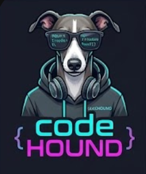

<p align="center">
  
</p>

<h1 align="center">codeHOUND</h1>
<p align="center"><strong>Good code. Found.</strong></p>
<p align="center">Find your projects. Remember the context. Get back to building.</p>
<p align="center">
  <a href="#install">Install</a> ·
  <a href="#the-dashboard">The dashboard</a> ·
  <a href="#configuration">Configure</a> ·
  <a href="#development">Develop</a>
</p>

That repo on the other drive. The branch you left half-finished. The promising project
with a name you can't quite remember.

**codeHOUND brings them back into view.** It finds Git repositories and loose software
projects across your disks, gathers their working state, and gives you one desktop
dashboard to search, revisit and launch them.


<p align="center"><em>The real dashboard, with illustrative project data. No private catalogue content.</em></p>

### Less archaeology. More building.

| Find your bearings | Pick up the thread | Open your tools |
| --- | --- | --- |
| Search projects, branches, paths and descriptions. Spot uncommitted work, duplicate clones and loose projects. | Five recently active projects, plus your pins. Saved summaries and last-commit context, with a fresh AI catch-up when you ask. | Launch your editor, terminal or file manager. Keep the dashboard close in the system tray. |

Built for Linux, at home on KDE/Plasma. Python + Qt, a local SQLite catalogue, and
launchers you control. **AI is optional**: finding, filtering and opening projects
works without a model. For AI features, choose a local service or a supported cloud
provider; the relevant project context is sent to that configured provider.

The hound in the corner is **Cody H. Ound**. He handles brand presence. You handle the code.

## Install

Requires Python 3.11+ and Git. The login integration uses desktop entries; scheduled
scans use a systemd user timer.

```bash
git clone https://github.com/zacpr/codeHOUND.git
cd codeHOUND
python3 -m venv .venv
.venv/bin/pip install -e .
source .venv/bin/activate

codehound app

# Optional desktop and background integration
codehound install-autostart   # app menu + start tray app at login
codehound install-timer       # systemd user timer: scan every 6h
```

On first launch, open **Settings → Scan** to choose your search roots, then hit
**Scan Now**. Review **Settings → Ollama** before scanning: scan-time enrichment is
enabled by default and uses a local Ollama service if available. The separate
**Settings → AI** tab configures Ask AI and project catch-ups.

Fedora/RHEL packaging is provided in [packaging/codehound.spec](packaging/codehound.spec).

## Usage

```bash
codehound scan              # scan configured roots, update DB, enrich via Ollama
codehound scan --root PATH  # scan one root only (repeatable)
codehound sync              # clone/fetch every repo from configured accounts
codehound ask "question"    # ask the AI across your whole project catalogue
codehound ask --path P "?"  # ask about one project
codehound app               # tray icon + dashboard
codehound adopt PATH        # copy a project into ~/repos under a unique name
codehound open NAME         # fuzzy-find a project and open it in the first launcher
codehound janitor           # dry-run: show clones whose remote work is done
codehound janitor --force   # actually remove them
```

## The dashboard

Cody H. Ound, the codeHOUND mascot, welcomes you in the top-left sidebar, with a
charcoal, cyan and violet theme throughout the dashboard and its dialogs. His
headshot also appears in the window, taskbar, app menu and tray. RPM installs include
the themed icons; editable installs can refresh them with `codehound install-autostart`.

- **Catalogue views** — all projects, working changes, Git repositories (including bare
  repos), loose projects, duplicate clones and missing paths. All projects retains missing
  entries; other views show live paths only, except the dedicated Missing paths view.
  The overview cards are shortcuts to these views; their counts cover the entire catalogue.
  At compact window heights the cards collapse, leaving the same counts in the sidebar.
- **Continue the hunt** — a manual carousel above the table features the five most
  recently modified live projects, plus any extra projects you pin. Pin from the inspector
  or the carousel; pins persist between launches. Unpinning a top-five project still leaves
  it in the recent five. Missing pinned paths stay saved but are not featured. The
  **Featured** toolbar toggle hides the carousel when you want more room for the table.
- Each featured card shows its **saved AI description** and **Previously…**, the last
  recorded commit (not a remembered chat). **Catch me up with AI** requests a fresh
  briefing from project files and git history, shown in the usual answer dialog. Browsing
  or pinning never calls a model. The carousel covers the catalogue independently of filters.
- **Search** within the selected view with `Ctrl+F`; reload from disk with `F5`.
  Project headings in the table, inspector and carousel use `project/branch` when
  both are known. You can search this combined label; the separate Branch column remains available.
  Click headers to sort or **drag headers to rearrange columns** (order persisted).
  **Columns** exposes all ten fields, including the path, root and creation date hidden
  initially to keep the table compact. Column visibility is per-window.
- **Inspector** — select a row for its description, location and latest commit. Pick a
  launcher, open the project, ask a question, copy its path or pin it. Hide the inspector
  with its toolbar toggle to give the table more room.
- Double-click still opens the first configured launcher. Right-click retains **all
  launchers**, **Ask AI**, **Open in file manager**, **Adopt into repos…** and **Copy path**.
- **Scan Now**, **Sync Accounts**, **Settings** and the tray menu remain available.
  **Activity** shows scan/sync/summary output without leaving the catalogue.

A **Status** column shows `▲ dirty` for uncommitted work — click it to sort dirty-first.

Badges on the Name column: `✱` uncommitted changes · `⧉` same remote cloned elsewhere ·
`⌂` already adopted into ~/repos. Grey rows were missing on the last scan.

## Configuration

Everything is editable in the app: **Settings** button on the dashboard (or **Settings…**
in the tray menu) — tabs for Scan (roots, excluded dirs/paths, depth, mount-point crossing),
Ollama, Launchers (add/edit/remove/reorder; the first entry is the double-click default)
and Adopt destination. Changes are saved to `~/.config/codehound/config.toml`, which you
can also edit by hand (created with defaults on first run):

- `[scan] roots` — directories to hunt; add/remove as needed
- `[scan] exclude_dirs` / `exclude_paths` / `max_depth` / `one_filesystem`
- `[ollama]` — `enabled`, `model` (default `gemma4:12b`, auto-pulled), `enrich`
  (one-line AI descriptions), `classify` (LLM decides if marker-less dirs holding loose
  code are projects)
- `[launchers]` — `name = "command {path}"`, shown in order in the context menu; the first
  one is the double-click default
- `[adopt] dest` — where adopted projects are copied (default `~/repos`)
- `[clone] dest` — where synced account repos live, laid out as
  `<dest>/<host>/<owner>/<repo>` (default `~/repos`, so they show up in the dashboard)
- `[[accounts.github]]` — `user` (label), `token` (PAT; blank = use the **gh** CLI login),
  `orgs` (also mirror these), `forks`, `archived`
- `[[accounts.azure]]` — `org`, `pat` (blank = use the **az** CLI login),
  `projects` (blank = all projects in the org)
- `[ai]` — model connection for `codehound ask` / the dashboard's Ask AI actions:
  `provider` (`ollama` local by default, or `openai`, `gemini`, `kimi`, `custom`),
  `model` / `base_url` (blank = provider default), `api_key` (blank = env var:
  `OPENAI_API_KEY`, `GEMINI_API_KEY`, `MOONSHOT_API_KEY`), and `catalogue_summary`
  (see below)

## Catalogue summaries

With `[ai] catalogue_summary = true` (Settings → AI), the model writes a compact digest
of the catalogue after each scan (`codehound ask --refresh-digest` to do it by hand).
Catalogue questions then answer from the digest plus a compact name/path appendix —
one model call, no re-feeding of the whole project list. Freshness comes for free from
the scanner: each scan refreshes every project's `modified` stamp from directory mtimes,
so the digest is flagged **stale** (CLI note, Ask AI tooltip/menu, tray) as soon as any
project's folder changes after it was written — no file watcher needed.

## Account mirroring

`codehound sync` lists every repo in your configured GitHub / Azure DevOps accounts,
clones the missing ones, and fast-forwards the rest (`git fetch --all --prune` +
`git pull --ff-only`). Clones with uncommitted or diverged work are fetched but never
pulled, so local work is never clobbered. The systemd timer runs `sync` before each scan.

Providers are modular: `codehound/providers/` holds one module per host behind a common
`Provider` interface with pluggable auth backends (`gh` CLI, PAT, `az` CLI, bearer
headers) — adding GitLab etc. is one new module plus a registry entry. AI chat works the
same way via `codehound/ai/`: any OpenAI-compatible endpoint is a one-line preset.

## Janitor

`codehound janitor` (dry-run by default) asks each configured provider which repos are
finished — **GitHub**: archived repos; **Azure DevOps**: disabled repos and branches whose
PRs are completed or abandoned. A clone is only listed (or removed, with `--force`) when
it has no uncommitted changes and no unpushed commits. Settings → Janitor has the toggle,
an exclude list (repo names or full paths), and a dry-run button.

## How detection works

- A directory containing `.git` → **git** project (branch, remote, last/first commit, dirty
  state collected via git).
- Otherwise a directory containing a project marker (`package.json`, `pyproject.toml`,
  `Cargo.toml`, `go.mod`, `*.sln`, `CMakeLists.txt`, …) → **ungitted** project.
- Found projects are not descended into; excluded dirs, other filesystems, and hidden dirs
  are pruned.
- Everything lands in `~/.local/share/codehound/codehound.db` (SQLite). Projects that
  disappear are kept, greyed out and flagged missing.

## Development

The dashboard tests use an isolated temporary catalogue and mocked launch/AI actions:

```bash
QT_QPA_PLATFORM=offscreen python -m unittest discover -s tests -v
```

The supplied mascot artwork lives in [codehound/assets](codehound/assets). Packaged
desktop icons use the distinct `codehound-cody` theme name so older cached icons do
not follow Cody into the new dashboard.
